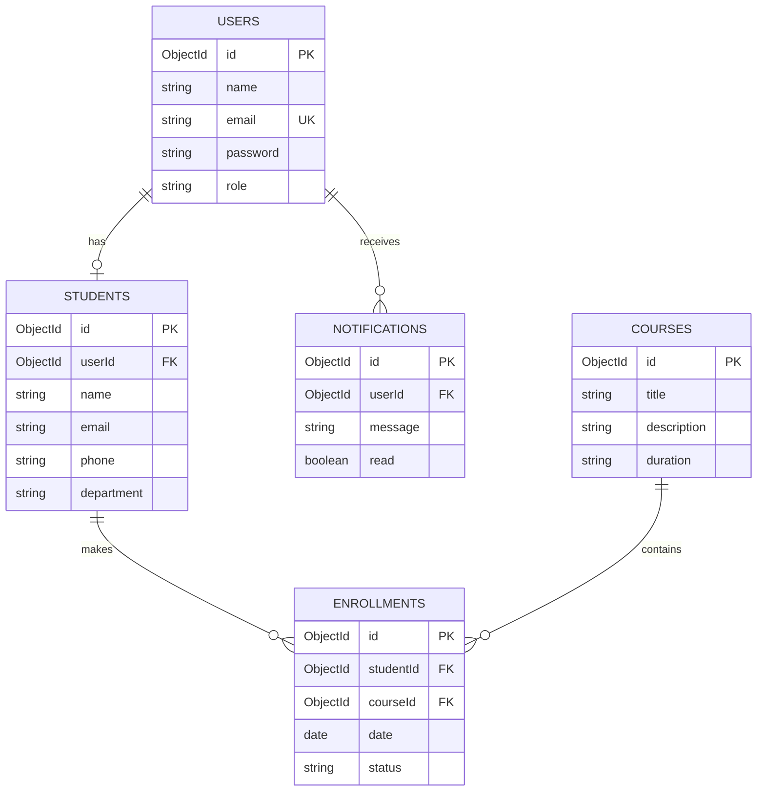

# FSD Task 11 – Database Schema Documentation

## 1. Database Selection
Database: MongoDB
ODM: Mongoose
Database Name: course_management

## 2. Collections

### Users
- _id: Primary identifier
- name: String, required
- email: String, required, unique
- password: String, required
- role: admin, student or teacher

### Students
- _id: Primary identifier
- userId: Reference to Users, unique
- name: String, required
- email: String, required, unique
- phone: String
- department: String

### Courses
- _id: Primary identifier
- title: String, required
- description: String
- duration: String, required
- instructor: String

### Enrollments
- _id: Primary identifier
- studentId: Reference to Students
- courseId: Reference to Courses
- date: Date
- status: active, completed or cancelled

### Notifications
- _id: Primary identifier
- userId: Reference to Users
- message: String, required
- read: Boolean

## 3. Relationships

1. One User can have one Student profile.
2. One Student can enroll in multiple Courses.
3. One Course can have multiple Students.
4. One User can receive multiple Notifications.

## 4. Constraints and Validation

- Required fields cannot be empty.
- Email addresses must be unique.
- User roles have predefined values.
- Enrollment status has predefined values.
- Duplicate student-course enrollments are prevented.
- MongoDB automatically generates unique ObjectIds.

## 5. Conclusion

The MongoDB database structure was successfully
created using Mongoose. Five collections were
created with appropriate fields, relationships,
validation rules and constraints.

## 6. Entity Relationship Diagram

